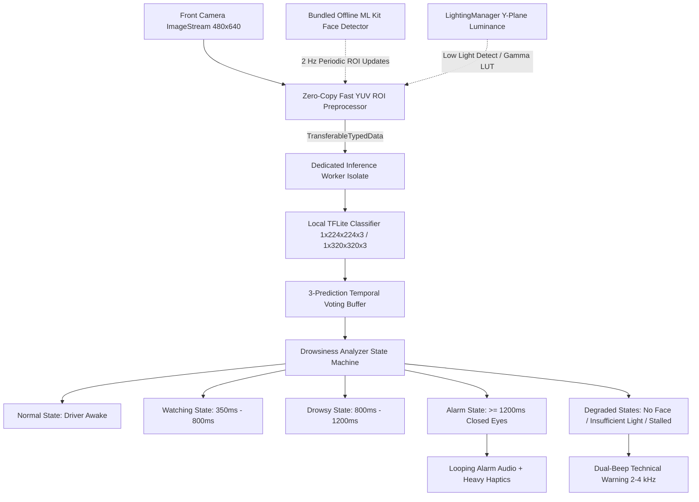

# DriveAlert (Safe Drive Monitor) — System Architecture

## 1. High-Level System Overview

`DriveAlert` (`safe_drive_monitor`) is an offline, real-time Flutter/Android safety application designed to detect driver drowsiness and micro-sleep events via front-facing camera imagery. The application adheres to the **Golden Rule of Safety**: *The system must never fail silently.* Any camera freeze, inference stall, lighting loss, or face loss immediately triggers an audible, distinct warning tone.

---

## 2. Processing Pipeline

### 2.1 Camera Stream & Zero-Copy YUV ROI Extraction (`image_preprocessor.dart`)
- **Fast Single-Pass Sampling**: Avoids full-frame allocations, intermediate `img.Image` conversions, and heap copying by sampling directly from raw YUV planes into a normalized Float32List via integer math in under 2ms.
- **Supported Pixel Formats**: Triplanar `YUV420_888`, biplanar `NV12`/`NV21`, single-plane `NV21`, and iOS `BGRA8888`.
- **Precomputed Gamma LUT**: When low ambient light is detected (`luminance < 40`), a 256-entry gamma lookup table ($\gamma = 0.75$) lifts shadows without runtime `pow()` calculations.

### 2.2 Offline Face Tracking (`face_roi_detector.dart`)
- **Bundled Google ML Kit (`com.google.mlkit:face-detection:16.1.7`)**: Statically included inside the APK, ensuring 100% functionality without Play Services dynamic model downloads or internet connectivity.
- **Smooth ROI Geometry**: Expands detected eye coordinates by 60% horizontally and 120% vertically, squares dimensions, clamps within sensor bounds, and applies Exponential Moving Average ($\alpha = 0.6$) coordinate smoothing.
- **Secondary Signal Rule**: TFLite remains the primary eye-state decision maker. If ML Kit's native `eyeOpenProbability` strongly conflicts with TFLite ($> 0.6$ discrepancy), inference rate is accelerated to resolve ambiguity without overriding TFLite.

### 2.3 Dedicated Inference Worker Isolate (`inference_worker.dart`)
- **Dedicated Isolate**: Inference runs off the Flutter UI thread on a long-lived isolate, guaranteeing 0 UI frame drops.
- **Zero-Copy Tensor Transfer**: Transfers preprocessed Float32 buffers via zero-copy `TransferableTypedData`.
- **Interpreter Configuration**: Configured with `threads = 2`, `useNnApiForAndroid = false`, and `XNNPackDelegate` fallback for maximum CPU stability.

---

## 3. State Machine & Transition Rules

| State | Eye Closure Duration | Audible Action | Haptic Action | Recovery Criteria |
|---|---|---|---|---|
| **Normal** | Eyes open | Silent | None | N/A |
| **Watching** | 350ms – 800ms | Silent | Subtle tick | Immediate on open eye frame |
| **Drowsy** | 800ms – 1200ms | Silent / Visual Warning | Intermittent pulse | Immediate on open eye frame |
| **Alarm** | $\ge$ 1200ms | Continuous loud siren (`alarm.mp3`) | Intense looping haptics | Requires 800ms rolling recovery window |
| **Recovering** | Reopening eyes | Sustained siren | Sustained haptics | Confirmed after 800ms open eyes |
| **noFaceDetected** | Face missing > 2s | Technical tone (`warning.mp3`) | Double pulse | Face relocated |
| **insufficientLight** | Lum < 15 for 3s | Technical tone (`warning.mp3`) | Double pulse | Lum $\ge$ 40 |
| **monitoringStalled** | Frame stall > 3s | Loud alert tone (`alarm.mp3`) | Persistent pulse | Stream restored or app restart |
| **thermalThrottled** | Device thermal severe | Technical tone (`warning.mp3`) | Single pulse | Device cooled down |

---

## 4. Real-World Driving Robustness

### 4.1 OLED Level 1 Driving Mode (`camera_feed_view.dart`)
- Screen displays pure AMOLED black (`#000000`), unmounting `CameraPreview` to eliminate GPU OpenGL rendering and prevent phone overheating.
- Subtle green breathing pulse indicates active background monitoring.
- Tapping anywhere wakes a minimal HUD for 5 seconds (`wakeTemporaryHud`).
- If an alarm triggers, the screen immediately wakes up and pulses red.

### 4.2 Audio & Power Management
- `AudioContextAndroid` configured with `usageType: AndroidUsageType.alarm`, `contentType: AndroidContentType.sonification`, `isSpeakerphoneOn: true`, and `audioFocus: AndroidAudioFocus.gainTransientExclusive` (ducks background music/podcasts).
- `wakelock_plus` prevents CPU sleeping or screen shutdown during active driving sessions.
- Foreground service maintains continuous camera stream and watchdog heartbeats.

---

## 5. Intellectual Property & Environment Security

- **Build-Time Model Encryption**: Neural network weights are encrypted with AES-256-GCM using `tool/encrypt_model.dart` / `tool/encrypt_model.js` creating a secure `SDM_ENC\x01` container.
- **In-Memory Native Decryption**: Decrypted on startup via Android MethodChannel (`decryptModelBuffer`). Key is derived natively using SHA-256 over package identity and internal salt. Decrypted bytes exist strictly in RAM and are passed directly to `Interpreter.fromBuffer(modelBytes)`.
- **Environment Integrity**: Non-blocking checks for `su` binaries, test-keys, debugger attachment, and Frida hooking sockets. Emits internal security warnings without disrupting driver safety monitoring.
- **Zero Network Footprint**: `android.permission.INTERNET` is explicitly removed (`tools:node="remove"`).

